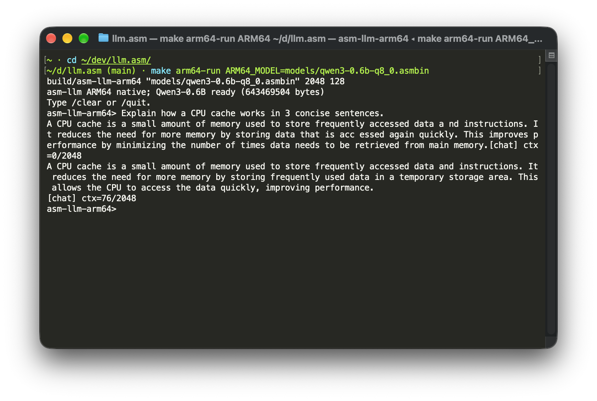

# Native ARM64 Qwen3-0.6B

This is an AArch64 port of the inference path in `01-qwen3-inference` and its
model/tokenizer formats. It consumes the same `.asmbin` exported by
`scripts/export_weights.py`, implements the same Q8_0 transformer and BPE
tokenizer, and uses ARM NEON integer dot products. It runs as a native macOS
process on Apple Silicon; it does not boot the x86 bare-metal OS in
`02-baremetal-os`.

## Build and run

Requirements: Apple Silicon macOS, Xcode command line tools, Python 3, and
NumPy. From the repository root, download and export the official Qwen3-0.6B
weights, then build and run:

```sh
python3 -m pip install numpy
./scripts/download_qwen3_06b.sh
make arm64
make arm64-run ARM64_MODEL=models/qwen3-0.6b-q8_0.asmbin
```

The executable starts an interactive multi-turn prompt. `/clear` resets the
context; `/quit` exits.
Optional Make variables: `ARM64_CTX` and `ARM64_TOKENS`.

## OpenCode and the OpenAI-compatible API

The Python standard-library server exposes the native ARM64 worker as an
OpenAI-compatible chat-completions endpoint, converting Qwen3 `<tool_call>`
output in either JSON or XML-shaped form. The HTTP/API layer is portable across
operating systems with Python 3; the inference worker in this directory is
still an ARM64/NEON binary. An OpenCode client on another machine can connect
to this API over the network or an SSH tunnel.

Start the server from the repository root:

```sh
make arm64
python3 arm64/openai_server.py models/qwen3-0.6b-q8_0.asmbin --port 8081
```

Or manage the interactive CLI and API server on macOS with:

```sh
./scripts/macos-arm64.sh server-start
./scripts/macos-arm64.sh status
./scripts/macos-arm64.sh server-stop
```

Add this provider to `opencode.json` (OpenCode v2.3.0 configuration syntax):

```json
{
  "$schema": "https://opencode.ai/config.json",
  "provider": {
    "arm64": {
      "name": "Native ARM64 Qwen",
      "npm": "@ai-sdk/openai-compatible",
      "options": { "baseURL": "http://127.0.0.1:8081/v1" },
      "models": {
        "qwen3-0.6b": {
          "name": "Qwen3 0.6B ARM64",
          "id": "qwen3-0.6b-arm64",
          "tool_call": true,
          "limit": { "context": 32768, "output": 256 }
        }
      }
    }
  },
  "model": "arm64/qwen3-0.6b"
}
```

The OpenCode context value accommodates its system and tool descriptions; the
inference worker still uses the 2048-token model context by default. The server
listens on localhost by default. For remote access, bind it to a reachable
interface and protect it with a firewall or SSH tunnel.

Run evidence from Apple Silicon:



The original x86-64 targets and their bare-metal kernel remain separate.

## Metal backend (experimental)

On Apple Silicon, `make arm64-metal` builds an alternate backend that dispatches
the Q8_0 matrix-vector projections, including the output vocabulary projection,
to the Metal GPU. Tokenization, normalization, RoPE, attention, and the KV cache
still run on the CPU. The original `make arm64` target remains the NEON CPU
backend. The Metal backend currently copies the model into a shared Metal buffer
at startup and synchronizes each projection, so benchmark it on your machine
before choosing it as the default.

The shader is compiled from source by the Metal API when the backend starts,
so the optional command-line Metal Toolchain is not needed. Build and run:

```sh
make arm64-metal
make arm64-metal-run ARM64_MODEL=models/qwen3-0.6b-q8_0.asmbin
```

To expose the Metal worker through the same OpenAI-compatible API for OpenCode:

```sh
ARM64_BACKEND=metal ./scripts/macos-arm64.sh server-start
```

Use `ARM64_BACKEND=cpu` (the default) for the NEON server. Both modes use the
same OpenCode provider configuration and HTTP port.
